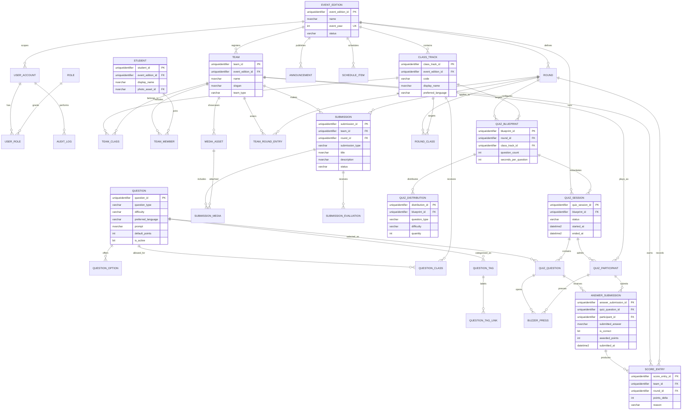

# UNKNOWN Database Design

Status: implemented design baseline; SQL Server migration source is in `database/sqlserver/001_initial_schema.sql`.

## 1. Requirements captured

### Event and records

- Preserve data across annual editions of the TLC event.
- Keep classes, rounds, schedules, announcements, rules, and results scoped to an event edition.
- Store learning-stage teams and main-event mixed teams without duplicating students.
- Store member names and optional student profiles/photos.
- Store team logo, slogan, posters, project links, evidence, and other showcase media.
- Keep a score history, not only a mutable total, so results can be explained and corrected.
- Keep an audit trail for administrative changes.

### Quiz competition

- Support Classes IX, X, and XI with class-specific preferred programming languages.
- Store reusable questions independently of a single quiz run.
- Support MCQ, riddle, code snippet, debugging, conceptual, and theory categories.
- Support difficulty, language, points, explanations, options, and correct answers.
- Select questions randomly while enforcing an administrator-defined distribution.
- Preserve the exact question order and version used in every quiz session.
- Record team joins, buzzer presses, answer attempts, correctness, response time, and awarded points.
- Support live leaderboards while retaining an immutable scoring ledger.

### Security and operations

- Keep authentication and authorization data separate from public student/team profiles.
- Store only password hashes, never passwords.
- Restrict sensitive answer keys to server-side/admin access.
- Use foreign keys, unique constraints, check constraints, transactions, and indexes.
- Retain history for corrections and future annual reporting.

## 2. Recommendation

Use **Microsoft SQL Server** as the database engine for this project. The requested model is relational, has many-to-many relationships, requires transactional quiz scoring, and needs durable audit/history. SQL Server also provides system-versioned temporal tables for point-in-time history and supports row-level security if the application later needs database-enforced tenant or role boundaries. See the official references in the project handoff.

MongoDB Compass is not a database engine; it is a GUI used to connect to MongoDB deployments. A document model could work for a prototype, but it would make team membership, event editions, question distributions, quiz attempts, and scoring history less constrained and harder to report consistently.

Recommended deployment path:

1. Develop with SQL Server Developer or Express locally.
2. Use SQL Server/Azure SQL in production, with encrypted connections, separate application credentials, automated backups, and migrations.
3. Keep the existing repository interfaces and add SQL Server implementations behind them.
4. Keep media binaries in object storage or a managed file store; store only metadata and secure object keys in SQL Server.

## 3. ERD

## 4. Entity decisions

### Event edition and classes

`EVENT_EDITION` is the annual boundary. Never hard-code 2026 into table design. `CLASS_TRACK` belongs to an edition, so IX/X/XI can have different language or rules in a later year.

### Teams and students

`STUDENT` is the person record. `TEAM_MEMBER` is dated membership. `TEAM` is a competition unit and can be `LEARNING` or `MIXED`; `TEAM_CLASS` allows a mixed team to contain members from several classes without duplicating teams.

### Media and showcase content

`MEDIA_ASSET` stores title, type, alt text, object-storage key, checksum, moderation state, and visibility. It deliberately does not store large binary files in SQL Server. The same pattern supports logos, posters, member photos, project screenshots, and evidence files.

`SUBMISSION` stores the work produced for a round (presentation, poster, project, debugging response, or programming solution). `SUBMISSION_MEDIA` attaches one or more assets and `SUBMISSION_EVALUATION` records criterion-level judging, so “effort” is represented as auditable event work rather than an unstructured note.

### Questions and distribution

The question bank is reusable. `QUESTION_CLASS` determines which classes may receive a question. `QUESTION_TAG` supports additional labels without changing the schema. `QUIZ_BLUEPRINT` defines the target count/time for a class and round; `QUIZ_DISTRIBUTION` defines required quantities by type and difficulty. The application validates that distribution quantities add up to the blueprint count before starting a session.

### Quiz execution and scoring

`QUIZ_SESSION` is an actual run. `QUIZ_QUESTION` snapshots the selected question and order so later edits to the bank cannot rewrite historical results. `QUIZ_PARTICIPANT`, `BUZZER_PRESS`, and `ANSWER_SUBMISSION` capture the live event. `SCORE_ENTRY` is append-only in normal operation; the leaderboard is a query over score entries, not a hand-edited total.

## 5. Required invariants

- A team name is unique within an event edition.
- A student can have at most one active membership in a given team at a time.
- A question option belongs to exactly one question; an MCQ must have at least two options and exactly one correct option.
- A quiz blueprint can target one round and one class only.
- Distribution quantities must be positive and sum to `question_count`.
- A quiz session can select each question at most once.
- A participant can submit at most one final answer per quiz question; retries may be stored as separate drafts only if explicitly enabled.
- Only one accepted buzzer winner exists for a quiz question.
- Score entries are immutable after publication; corrections use a compensating entry.
- Public-facing queries must exclude answer keys, private student fields, audit details, and unmoderated media.

## 6. Delivery phases

1. Apply and review `001_initial_schema.sql` on a non-production SQL Server database.
2. Add a migration runner and SQL Server repository implementations for teams, questions, quizzes, and score entries.
3. Replace in-memory bindings in `server/container.ts` behind a feature flag.
4. Add seed data for one event edition, IX/X/XI, and current teams; do not seed real passwords or private photos.
5. Add transactional quiz-start selection, answer submission, and score publication.
6. Add media upload to object storage and persist only metadata in `MEDIA_ASSET`.
7. Add backup/restore rehearsal, audit review, and load testing before the live event.
